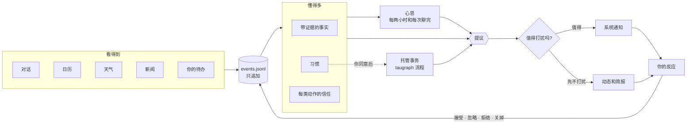
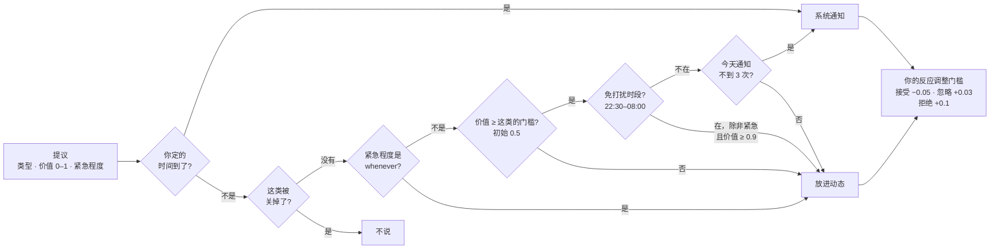

# moqi（默契）

[](https://github.com/wangcao-hub/moqi/actions/workflows/ci.yml) [](https://www.npmjs.com/package/moqi-agent) [](./LICENSE)

**不用开口就懂你的个人 agent。** 它从你的日常里了解你，在合适的时候先开口，越用越懂你。

[English](./README.md) · [设计](./docs/design.md) · 基于 [taugraph](https://github.com/wangcao-hub/taugraph)

大多数助理等你来问。moqi 反过来：每隔两小时，以及每次和你聊完，它都会自己想一想，能替你做点什么、该问你点什么好更懂你、外面有什么和你有关的事。你问过三次的事，第四次它直接告诉你；明天要下雨，它前一晚提醒你带伞。你告诉它要做的事，它替你记着：你定了时间的提醒一定准时到，没做完的挪到明天。它也知道什么时候该闭嘴：晚上不打扰、一天最多打扰三次、你嫌烦的那类事它会越来越少说。

内核是纯 TypeScript，不依赖 Node 专有 API，同一份代码可以跑在电脑上，也可以放进手机 App。

## 怎么运转

moqi 看到的、说过的、做过的，全部是一份只追加日志里的事件，用户模型由这份日志重放得到。它想对你说的每一句话都先变成一条**提议**，要过几道关才能打扰你；你的反应再写回日志。



一条提议怎么到你面前。你给待办定的时间到了，提醒直接弹通知；其他提议都要过下面这几关。图里是默认值，每一类提议各自学自己的门槛：



## 设计取舍

| 取舍                                                                                                                                                                                                                                                                       | 为什么                                                                                                                                                         |
| -------------------------------------------------------------------------------------------------------------------------------------------------------------------------------------------------------------------------------------------------------------------------- | -------------------------------------------------------------------------------------------------------------------------------------------------------------- |
| **它会自己想。** 你醒着的时候每两小时一次，以及每次聊完 10 分钟后，moqi 请模型想最多三个点子：替你做一件事（动作已经备好，点一下就办）、问你一个问题好更懂你（每天最多两个）、从你订阅的新闻里挑和你有关的                                                                 | 主动就是没人问的时候也在想。点子和别的提议过同样的关：只有今天就要用上的才会打扰你，一周内不重复，控制台里能看到它想过的每一件事，以及为什么说了或没说         |
| **你不在时它会自学。** 你半小时没说话、又不在免打扰时段时，moqi 每天最多学三次。有新的反应可以复盘时，它总结经验（比如"天气提醒放在早上 7 点前更常被接受"），被推翻的旧经验会撤掉；否则它按你的档案挑一个主题，读信息源里的一两篇原文，记下带出处的笔记                    | 帮得好要靠练，不只靠记。经验和笔记会用在每次对话和每次想点子里；「记忆」页能看到每一条和它的出处，可以删。它只读自己的信息源列出的文章，模型没法让它去别的网址 |
| **开口是有代价的。** 每条主动消息都是一条带价值的提议。它要超过这一类学到的门槛、不在免打扰时段、还有当天的打扰额度，才会弹通知                                                                                                                                            | 主动但不吵。你总拒绝的那类越来越少出现，你常接受的那类更容易送到                                                                                               |
| **你定的时间一定算数。** 你给待办定了时间，就在那个时间提醒你，免打扰时段和每天的条数限制都拦不住，也不占条数。没做完的自动顺延，标出拖了几天；每晚 21:00 列出还剩什么。                                                                                                   | 免打扰和条数限制管的是 moqi 自己开口；你亲口定的时间，本身就是同意被打扰。                                                                                     |
| **信任按事情一件一件挣。** 每类动作沿 `inform → suggest → auto-undo → auto` 往上走。连续同意 3 次，moqi 才问要不要升一级；拒绝一次降回 `suggest`。新建文件夹、新建文件、移动、改名、写剪贴板、盯梢、删除待办这些普通动作，也可以在设置里直接设成不用问                     | 没有全局的"自动模式"。查天气可以自己跑，会改变外部世界的事照样先问。删除记忆封顶在 `suggest`                                                                   |
| **危险动作只由你放开。** MCP 服务器和 A2A agent 提供的写工具每次都问，确认框里显示它到底要做什么。你可以在设置里放开某一个，也可以把一个服务器的工具整组放开（要再点一下确认），moqi 自己永远不会提议放开；就算放开了，这一轮读过网页、文件或别的 agent 的消息，仍会再问。 | moqi 读进来的内容里藏着的指令，不能直接在你的电脑上动手。你装的服务器本来就以你的权限运行，所以它标的"只读"照信；写工具无不无害，只由你判断。                  |
| **网站按轮授权，也可以一直允许。** 在网页上，moqi 打开每个网站前问你一次，之后在这个网站上浏览、点击不再问。选「以后都允许」，这个网站以后都不再问，设置里能看到并移除。输入文字、填表、上传、执行脚本每次都问。                                                           | 能把你的信息带出去的，是模型自己写出来的东西：网址和输入的文字。网页上的链接来自网页本身，网页作者并不知道你的信息。                                           |
| **编程任务以分支的形式交回来。** 编程 agent 在自己的工作区里做，moqi 把结果提交到任务分支。你在动态里看改动，点一下写着分支名的"合并"按钮，或者整个丢掉。                                                                                                                  | agent 一次可能改十几个文件。分支能完整地看、完整地丢，也不会和你在项目里正在做的事打架。                                                                       |
| **记忆带证据。** 同一事实印证 3 次转为长期，30 天没再印证就淡出；前后矛盾时变成一个问题交给你                                                                                                                                                                              | 模型不会悄悄改写它对你的了解                                                                                                                                   |
| **重复变成自动化。** 最近 14 天里有 3 天用同样的参数调用同一个工具，每次都在平时那个时间前后一小时内，moqi 就提议以后替你做                                                                                                                                                | 自动化不用你去设置，moqi 看出习惯，问你一次                                                                                                                    |
| **托管事务是确定性流程。** 每件托管事务按 [taugraph](https://github.com/wangcao-hub/taugraph) 流程跑：检查（只读）、比较（代码）、提醒（唯一的写步骤），不调用模型                                                                                                         | 便宜、可预期，重放一次运行也不会重复提醒你                                                                                                                     |
| **学习不挡在回答前面。** 每 3 轮对话，后台另发一次请求抽取事实                                                                                                                                                                                                             | 回答不用等记忆；本机小模型也不用一边回答一边抽取                                                                                                               |
| **一份日志就是全部状态。**                                                                                                                                                                                                                                                 | 备份就是复制一个文件，排查问题就是读它，以后多设备同步就是同步这份日志                                                                                         |

## 快速开始

需要 Node.js 22 或更高版本。npm 上的包名是 `moqi-agent`，装好后的命令是 `moqi`。

```
npm install -g moqi-agent
moqi             # 在后台运行 moqi，并在浏览器里打开控制台
```


控制台的地址是 **http://moqi.localhost:6674**（6674 在手机键盘上就是 MOQI）。第一次 `moqi` 会用带钥匙的链接打开它，浏览器记住钥匙之后，直接输入这个地址就行。如果你的浏览器打不开 `moqi.localhost`，用 `http://localhost:6674`。

控制台有五个栏目：**对话**；**待办**（今天的、以后的和最近完成的，可以勾掉、删除，也能加一件，日期和提醒时间可选）；**动态**（moqi 主动想告诉你的事、它问你的问题（可以直接回答），以及「moqi 在想」：它想过的每个点子和结果）；**记忆**（它记住了你什么、自己学到了什么、替你盯着什么，记错的可以删）；**设置**。第一次打开会直接进设置：选一个模型，点「测试连接」，搜一下你的城市，选几个新闻源，保存。改完立刻生效，不用重启。

在**对话**里，一条消息可以带最多 4 张图片：粘贴、拖进来或者点按钮选。moqi 第一次会测一下你的模型能不能看图（给它看一个红色方块，问是什么颜色），看不了图时图片按钮变灰；DeepSeek 的 `deepseek-flash` 能看。图片存在 `~/.moqi/media`，只发给你配置的模型。回答有排版：列表、加粗、带"复制"按钮的代码、表格、链接卡片，不渲染 HTML，也不从外面加载任何东西。工具带回的图片，比如浏览器截图、macOS 截图、MCP 服务器给的图，显示在回答下面，点一下放大看。在**动态**里，处理过的卡片收进「看过的」，保留 30 天，链接和结果都在，已合并的编程任务还能看改动。


任何 OpenAI 兼容的模型都可以。本机 Ollama 不用 key：`qwen3:4b`（2.5 GB）哪里都能跑；[Muse Glimmer](https://ollama.com/library/muse-glimmer) 是 Meta 给常驻本地 agent 做的开源模型，想得好得多，但要约 18 GB 磁盘、24 GB 以上内存。DeepSeek、通义千问这类云端模型要填 key。对话长了回答被截断的话，调大 Ollama 的上下文窗口，例如 `OLLAMA_CONTEXT_LENGTH=16384 ollama serve`。

| 命令          | 做什么                                                                                        |
| ------------- | --------------------------------------------------------------------------------------------- |
| `moqi`        | 后台的 moqi 没在运行就启动它，然后打开控制台                                                  |
| `moqi stop`   | 停掉后台的 moqi                                                                               |
| `moqi brief`  | 打印今天的简报                                                                                |
| `moqi chat`   | 在终端里对话，后台的 moqi 没在运行时可用（`/brief`、`/offers`、`/accept <id>`、`/memory` 等） |
| `moqi daemon` | 在前台运行、不开浏览器，给 launchd、systemd、pm2 这类服务管理器用                             |
| `moqi mcp`    | MCP 服务（stdio），让其他 agent 和 moqi 交流（见下文）                                        |
| `moqi a2a`    | 显示 moqi 的 A2A agent card 和钥匙，给支持 A2A 的 agent 用                                    |
| `moqi init`   | 写一份配置模板，给没有浏览器的机器用                                                          |

后台的 moqi 用系统通知（macOS、Linux）和控制台的动态找你。同一个目录同时只由一个 moqi 持有，控制台、`moqi brief` 和以后的手机都通过它读写。

```
你：我住在深圳南山，在一家互联网公司做产品
moqi：记住了
你：半小时后提醒我给妈妈回电话
moqi：记下了，11:10 提醒你给妈妈回电话。（进了待办，不用确认，到点一定提醒）
你：每天晚上 10 点提醒我早点睡
（控制台弹出：要我每天 22:00 提醒你「早点睡」吗？ 好 / 不用）
moqi：已设好，每天 22:00 提醒你早点睡。
```

## 能力包：网页、文件、你的 Mac

在「设置 → 能力包」里打开。会改动东西的动作照样先问你（见设计取舍）。

| 能力包     | moqi 能做什么                                                                      | 怎么保证安全                                                                                                                                                                    |
| ---------- | ---------------------------------------------------------------------------------- | ------------------------------------------------------------------------------------------------------------------------------------------------------------------------------- |
| 浏览器     | 打开网页、读内容、点击、后退、切换标签页；你同意后输入文字、填表                   | 用 Playwright 的 MCP 服务器和一个单独的 Chrome 配置，碰不到你平时的浏览器。每个网站每轮问一次，也可以选「以后都允许」；输入、填表、上传、执行脚本、没授权的网站每次都问         |
| 联网搜索   | 在后台搜网页、读网页，不开浏览器，不用你点确认                                     | 通过 DeepSeek 的 Search 和 Fetch 接口，或百度 AI 搜索。搜到的内容算外部内容，之后的危险动作照样要问。用百度时 moqi 自己下载网页，不读本机和局域网的地址，每次跳转都重新检查     |
| 文件       | 列出、读取、新建文件夹和新文件、移动、改名、移到废纸篓                             | 只在你选的文件夹里。不覆盖、不改已有文件的内容、不永久删除；符号链接跑不出去                                                                                                    |
| macOS      | 打开 App、在访达里显示文件、截图到桌面、音量、剪贴板，以及你勾选的快捷指令         | 固定命令，你的话只当数据传进去，不开放任意 AppleScript 或 shell。每个快捷指令是单独的危险工具，可以逐个放开                                                                     |
| 编程 agent | 把编程任务交给 Kiro CLI 或 Claude Code，在你登记的项目里做；做完看改动、合并或丢弃 | 每个任务一个单独的分支和工作区，合并之前不碰你的项目目录。只改工作区里的文件、只跑你列出的命令；Claude Code 的命令在它的沙箱里跑，不允许联网时连不上网（Kiro 列出的命令能联网） |

模型是 DeepSeek（`api.deepseek.com`）时，联网搜索自动打开，用模型的 key，搜索和读网页各是每 1000 次 0.75 美元。百度 AI 搜索要单独的 AppBuilder API Key，每天免费 100 次。在「设置 → 联网搜索」里可以关掉、换服务、填 key，「试一下」会真的搜一次。要登录、点按钮、填表的网页仍然用浏览器。

## 和其他 agent 协作（MCP 与 A2A）

### 其他 agent 通过 MCP 用 moqi

写代码的 agent 知道你在做什么，moqi 知道你是谁。`moqi mcp` 用 Model Context Protocol 把两边接起来：需要时它会先在后台启动 moqi，再和它通信，所以日志始终只有一个写入者。

| 工具            | 其他 agent 能用它做什么                                                                    |
| --------------- | ------------------------------------------------------------------------------------------ |
| `moqi_profile`  | 读 moqi 对你的了解，好让自己的工作更贴合你                                                 |
| `moqi_remember` | 记下它了解到的关于你的事；重复出现会印证，前后矛盾交给你定                                 |
| `moqi_tell`     | 告诉你一件事（比如"构建跑完了"）：由 moqi 决定弹通知还是放进动态，你可以单独关掉某个 agent |
| `moqi_todo`     | 往你的待办里加一件事（"明天 15:00 review PR #12"），moqi 会标明是哪个 agent 加的           |
| `moqi_ask`      | 和 moqi 说话：它用对你的了解和自己的工具（天气、日历、新闻）回答；要动手的事仍等你批准     |
| `moqi_feed`     | 看 moqi 正等着告诉你或问你的事                                                             |
| `moqi_briefing` | 今天的简报                                                                                 |

**moqi 会自己找。** 它会去 Kiro、Cursor、Claude Code、Claude Desktop、VS Code、Windsurf、Gemini CLI 存放设置的地方看看，也会在你的用户目录里找其他带 MCP 配置的 agent。找到后，在动态里问你一次（"发现你电脑上有 Kiro、Cursor，要接入 moqi 吗？"），点「好」就全部接上。控制台的设置里也会列出找到的每个 agent，可以单独接入或断开。moqi 只在配置里加一项 `moqi`，文件里原有的内容和权限都不变，第一次改之前先备份成 `.moqi-backup`，读不懂的文件一律不碰。写进去的是绝对路径，所以从程序坞打开的应用不依赖 shell 的 `PATH` 也能找到 moqi。接入后，在那个 agent 里新开一个会话，或刷新它的 MCP 设置，就能用了。

也可以手动接入：`kiro-cli mcp add --name moqi --command moqi --args mcp`；Cursor 在 `~/.cursor/mcp.json` 里写 `{ "mcpServers": { "moqi": { "command": "moqi", "args": ["mcp"] } } }`；Claude Code 用 `claude mcp add moqi -- moqi mcp`。

### 其他 agent 通过 A2A 和 moqi 说话

运行中的 moqi 在 `http://moqi.localhost:6674/.well-known/agent-card.json` 发布 [A2A](https://a2a-protocol.org) agent card，用 JSON-RPC 接收 `SendMessage`（A2A 1.0）和 `message/send`（0.3）。请求要带 moqi 的 A2A 钥匙：`Authorization: Bearer <钥匙>`，`moqi a2a` 和设置页都能看到。这把钥匙和控制台的钥匙分开，打不开别的东西。其他 agent 发来的话进入对话时会标上它的名字（`【名字】…`），moqi 不会把它当成你说的；由此引出的动作仍要你批准。moqi 用消息回答，不建长时间运行的任务。

### moqi 用其他 agent 的工具（MCP）和 agent（A2A）

- **MCP 服务器**：写在 `mcp.servers` 里的服务器，工具会变成 moqi 的工具，能在对话里用；只读的还能用在托管事务里。服务器标了只读的工具随时可用，其余的算危险工具，每次都先问你，直到你在设置里放开（见设计取舍）。moqi 也会发现你其他 agent 配好的 MCP 服务器（比如 Cursor 里的），主动问一次要不要也给它用；设置页里每个都有按钮。目前只支持 stdio 服务器。
- **A2A agent**：写在 `a2a.agents` 里的 agent 会变成 `ask_<名字>` 工具。moqi 发出去的内容会让对方看到，所以每次都先问你，直到你信任它。

## 配置

控制台的「设置」写的就是 `~/.moqi/config.json`，也可以手动改（目录可以用 `MOQI_HOME` 换）：

```json
{
  "model": { "baseURL": "http://127.0.0.1:11434/v1", "model": "qwen3:4b", "noThink": true },
  "persona": "回答尽量简短。",
  "briefingAt": "08:00",
  "todoReviewAt": "21:00",
  "quiet": { "from": "22:30", "to": "08:00" },
  "dailyBudget": 3,
  "weather": { "latitude": 22.54, "longitude": 113.93, "place": "深圳" },
  "calendar": { "ics": "~/calendar.ics" },
  "news": { "feeds": [{ "name": "少数派", "url": "https://sspai.com/feed" }] },
  "search": { "enabled": true, "provider": "deepseek" },
  "mcp": {
    "servers": {
      "files": { "command": "npx", "args": ["-y", "@modelcontextprotocol/server-filesystem", "/Users/me/Documents"] }
    }
  },
  "a2a": { "agents": [{ "name": "travel", "url": "https://travel.example", "key": "…" }] }
}
```

| 字段                  | 默认                    | 含义                                                                                                                                                                                           |
| --------------------- | ----------------------- | ---------------------------------------------------------------------------------------------------------------------------------------------------------------------------------------------- |
| `model`               | 无                      | OpenAI 兼容接口：`baseURL`、`model`，可选 `apiKey`。不配模型时，简报和托管事务照常工作，只是不能对话                                                                                           |
| `model.noThink`       | 关                      | 用在 Qwen3 这类会先"思考"的模型上：后台的短请求会带上 `/no_think`，避免小模型把 token 全花在思考上                                                                                             |
| `persona`             | 无                      | moqi 对你来说是谁，放在系统提示词最前面                                                                                                                                                        |
| `briefingAt`          | `"08:00"`               | 每日简报的时间；`null` 关掉简报                                                                                                                                                                |
| `todoReviewAt`        | `"21:00"`               | 晚间回顾的时间，列出今天还没做完的待办；`null` 关掉                                                                                                                                            |
| `quiet`               | 22:30 到 08:00          | 免打扰时段：提议先放进动态，除非紧急且价值 ≥ 0.9                                                                                                                                               |
| `dailyBudget`         | `3`                     | 每天最多几条通知                                                                                                                                                                               |
| `weather`             | 没设地点                | 天气插件（Open-Meteo，不需要 key）：`{ latitude, longitude, place }` 是你自己的地点。问别的城市也能查；moqi 知道你住在别处时，会问你一次要不要改过去                                           |
| `calendar`            | 关                      | 日历插件，读本机的 `.ics` 文件                                                                                                                                                                 |
| `news`                | 少数派、IT之家、Solidot | 新闻插件：读标题用的 RSS 或 Atom 源；`{ "feeds": [] }` 表示关掉。控制台里还可以选爱范儿、Hacker News                                                                                           |
| `search`              | 模型是 DeepSeek 时开    | 联网搜索：`enabled`、`provider`（`"deepseek"` 或 `"baidu"`），可选 `apiKey`。没有这一节时，模型接口是 `api.deepseek.com` 就打开并用它的 key；`"enabled": false` 之后一直关着。百度要单独的 key |
| `model.effort`        | 无                      | `low`、`medium` 或 `high`：后台请求的思考强度，给支持的模型用（Muse Glimmer、gpt-oss）                                                                                                         |
| `model.sendReasoning` | 开                      | 工具循环里把模型自己的思考以 `reasoning_content` 发回去，DeepSeek V4 和 Kimi 需要；Groq、Cerebras 这类不收这个字段的接口设成 `false`                                                           |
| `mcp.servers`         | 无                      | moqi 能用的 MCP 服务器（stdio），按名字：`command`、`args`、`env`、`cwd`                                                                                                                       |
| `a2a.agents`          | 无                      | moqi 能问的 A2A agent：`name`、`url`（agent 的网址或它的 card），可选 `key`                                                                                                                    |

环境变量：同时设置 `MOQI_BASE_URL` 和 `MOQI_MODEL` 会替换配置里的模型；`MOQI_API_KEY` 提供 key，不用写进文件；`MOQI_SEARCH_API_KEY` 提供联网搜索的 key（缺 key 时补上，但不会打开已经关掉或没有配置的搜索）。

## 它会主动做的事

| 什么时候                           | 做什么                                                             | 来自                  |
| ---------------------------------- | ------------------------------------------------------------------ | --------------------- |
| 每天早上（`briefingAt`）           | 简报：今天的日程、天气、替你留意的事、需要你定的事、今天要盯的事   | 内核                  |
| 每两小时，以及每次聊完             | 想点子：替你做一件事、问你一个问题、告诉你和你有关的新闻           | 内核（心思）          |
| 你不在的时候，每天几次             | 自学：从你的反应里总结经验，从和你有关的文章里记笔记               | 内核（自学）          |
| 你连续几天差不多同一时间问同一件事 | 问你"以后要不要每天这个时候直接告诉你"，你接受后自动建一件托管事务 | 内核（习惯识别）      |
| 托管事务到点                       | 查一次，和上次比，有变化（或设成每次）就告诉你                     | 内核（taugraph 流程） |
| 记忆前后矛盾                       | 请你定以哪个为准                                                   | 内核                  |
| 某类事你连续同意 3 次              | 问你以后要不要直接办                                               | 内核                  |
| 到了你给待办定的时间               | 提醒你，不受免打扰和条数限制                                       | 内核（待办）          |
| 每晚（`todoReviewAt`）             | 列出今天没做完的待办，没做完的顺延到明天                           | 内核（待办）          |
| 你连续三天加同一件待办             | 问你要不要改成每天提醒                                             | 内核（待办）          |
| 你在对话里提到要做的事             | 问你要不要记进待办                                                 | 内核（心思）          |
| 晚上 8 点后，明天要下雨            | 提醒带伞                                                           | 天气插件              |
| 日程前 30 分钟                     | 提醒你快开始了                                                     | 日历插件              |

## 当作库使用

```
npm install moqi-agent zod
```

插件提供工具、简报里的一节，以及每次心跳时要做的事：

```ts
import { defineTool, Moqi, openAICompatible, type Plugin } from "moqi-agent";
import { weatherPlugin } from "moqi-agent/plugins";
import { z } from "zod";

const water: Plugin = {
  name: "water",
  tools: [
    defineTool({
      name: "water_log",
      description: "今天喝了几杯水",
      input: z.object({}),
      effect: "read",
      run: () => ({ value: "3", headline: "今天喝了 3 杯水" }),
    }),
  ],
  briefing: () => ({ title: "喝水", lines: ["昨天只喝了 3 杯"] }),
  tick: (ctx) => {
    // 观察世界，有话要说时调用 ctx.offer(...)
    // 弹通知、放进动态还是不说，由 moqi 决定
  },
};

const moqi = new Moqi({
  model: openAICompatible({ baseURL: "http://127.0.0.1:11434/v1", model: "qwen3:4b" }),
  plugins: [weatherPlugin({ latitude: 22.54, longitude: 113.93, place: "深圳" }), water],
  deliver: (offer, surface) => console.log(surface, offer.title), // surface 是 "notify" 或 "feed"
});

console.log(await moqi.chat("明天要带伞吗？"));
setInterval(() => void moqi.tick(), 60_000); // 主动服务的心跳
```

`effect: "read"` 的工具随时可用，也能被托管事务调用；`"write"` 的工具从"先问你"开始，靠你的同意一步步获得信任。传入 `confirm: (question) => Promise<boolean>` 来问用户，不传的话，还没挣到信任的写操作一律拒绝。状态默认只在内存里；用 `moqi-agent/node` 里的 `fileEventStore` 可以存进 JSONL 文件。

`model` 接受任何 taugraph 的 `LLMModel`（`{ id, complete(request, { signal }) }`）；`openAICompatible` 用于 OpenAI 兼容接口。每轮对话是一次 [`taugraph/agent`](https://github.com/wangcao-hub/taugraph) 运行，每次托管事务是一次 taugraph 流程运行；传入 `onTrace` 可以逐个收到它们的 trace 事件。

## 数据与隐私

所有状态都由事件日志重放得到：`~/.moqi/events.jsonl`，只追加，一行一个事件。API key 不进日志，`config.json` 创建时只有你自己能读。

每轮对话和每次托管事务还会在 `~/.moqi/runs/` 下留一份 trace，一次运行一个 JSONL 文件，记下每次发给模型的请求（含带着记忆的系统提示词和对话）、模型的回答，以及每次工具调用和它返回的内容（文件、剪贴板、网页）。trace 用来回头排查，以后也用于改动之后回放真实对话；状态仍然只由事件日志决定。trace 保留 30 天，目录只有你自己能读，里面的图片只记 `media:<编号>` 引用，不记图片数据。

控制台只监听 `127.0.0.1`。它的地址在 `#` 后面带一把随机钥匙，所以钥匙不会出现在任何服务器日志里；每个接口都要出示这把钥匙；`Host` 不是本机的请求一律拒绝（防 DNS 重绑定）；页面在严格的内容安全策略下不加载任何外部资源。保存过的 API key 不会发回页面。

会离开你电脑的有：发给你配置的模型接口的请求（对话内容，加上 moqi 放进提示词的记忆和新闻标题）；开了天气插件时，发给 Open-Meteo 的坐标；下载你选的新闻源，以及 moqi 自学时读的原文；开了联网搜索时，搜索词和要读的网址发给 DeepSeek（模型就是 DeepSeek 时，就是对话已经在用的那家）或百度；还有 moqi 发给你添加的 A2A agent 的内容（每次都经你同意）。你添加的 MCP 服务器在你的电脑上、以你的权限运行。用本机模型、又没添加 A2A agent 时，关于你的信息一点都不会出去。控制台和 A2A 只监听 `127.0.0.1`，别的电脑访问不到。

用百度时，moqi 自己下载要读的网页，只读公网的 `http` 和 `https` 地址：网址里不能带用户名或密码，不读 `localhost`、不带点的单段域名、`*.local`、`*.lan`、`*.home`、`*.internal`、`*.home.arpa`、`*.localdomain`，不读回环、私网、链路本地和 CGNAT（100.64.0.0/10）的 IP，每次跳转都重新检查（最多 5 次），只读文字网页，最多 2 MB，20 秒超时。它看不到公网域名解析成了什么地址，所以指向你局域网的域名（DNS 重绑定）防不住；控制台没有钥匙的请求一律拒绝。

一轮对话读到外部内容（网页、搜索结果、别的 agent 的话）之后，`web_read` 只读这一轮里原样出现过的网址：你的消息、记忆和最近的对话、工具的结果。模型自己拼出来的网址可能把你的话带给那个网站，所以不读，moqi 会让模型请你把网址发过来。

## 现状与限制

目前只在电脑上运行。已经可用的：内核、控制台、命令行、天气/日历/新闻插件、系统通知、待办与提醒、托管事务、习惯识别、心思与自学，以及双向的 MCP 和 A2A。

- 手机 App 和多设备同步还没做（P1）。内核已经按能跑在手机里的标准写，有测试检查。
- 日历只读单次日程，重复日程（RRULE）暂时不展开。
- macOS 操作和快捷指令只在 macOS 上有；Linux 上只有浏览器和文件。
- 联网搜索支持 DeepSeek 和百度。要用别的服务，可以接它的 MCP 服务器。
- 系统通知上没有按钮（macOS 的通知来自 `osascript`）。勾掉提醒要去控制台的「动态」或「待办」，或者在对话里说一声。
- 待办不能设成重复。每天、每周都要做的事，直接说"每天……提醒我"，moqi 会建一件托管事务。
- 用本机 4B 小模型时，后台抽取偶尔会把一次性的请求当成事实；换更大的模型会好很多。你随时可以用 `/memory` 查看，用"忘掉某某"删除。
- 心思的质量取决于模型。用 `qwen3:4b` 时，想一次大约一分钟，能想出一到三个点子，有时一个也没有；换更大的模型，比如本机的 [Muse Glimmer](https://ollama.com/library/muse-glimmer) 或云端模型，会想得好得多。
- "办完可撤销"这一级目前的意思是"直接办，并告诉你"，撤销要靠对应的取消操作。
- 终端对话（`moqi chat`）还不能连到后台的 moqi 上；后台运行时请用控制台。
- A2A 只支持 JSON-RPC，用消息回答（没有流式、任务和推送通知）。MCP 客户端只支持 stdio 服务器，只用工具（不用 resources 和 prompts）。

## 开发

```
pnpm install
pnpm check      # 类型检查、lint、测试（测试固定在 Asia/Shanghai 时区）
```

## 许可证

[Apache License 2.0](./LICENSE)。你可以使用、修改、再发布 moqi，也可以用在商业产品里。发布 moqi 或基于它的作品时，要附上 [LICENSE](./LICENSE) 和 [NOTICE](./NOTICE) 两个文件，让 moqi 的出处跟着你的版本走，并标明你改过哪些文件。

0.5.0 及以前的版本以 MIT 协议发布，这些版本仍然适用 MIT。
